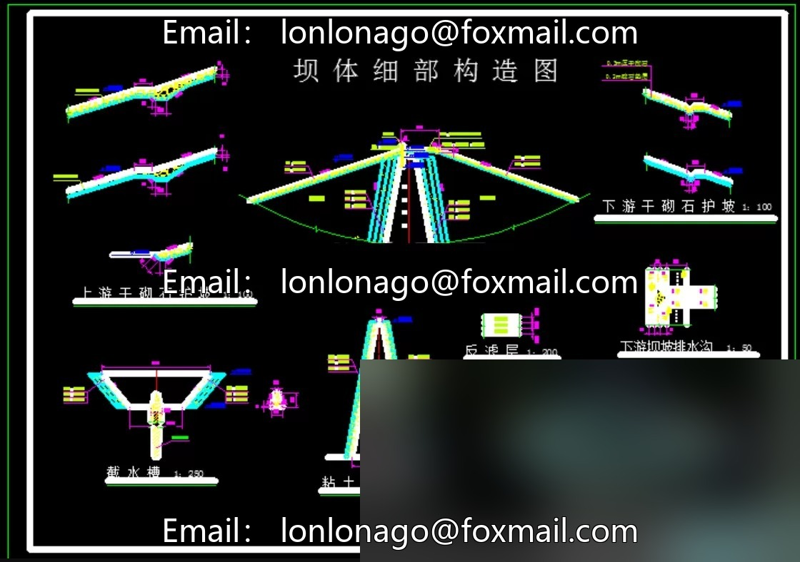
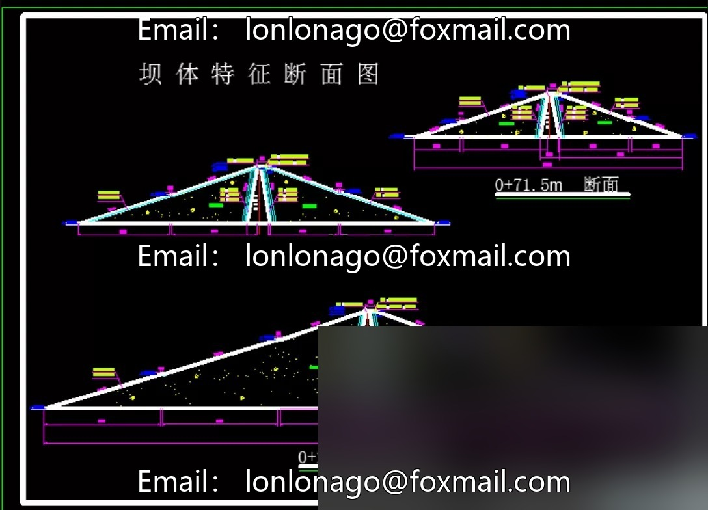
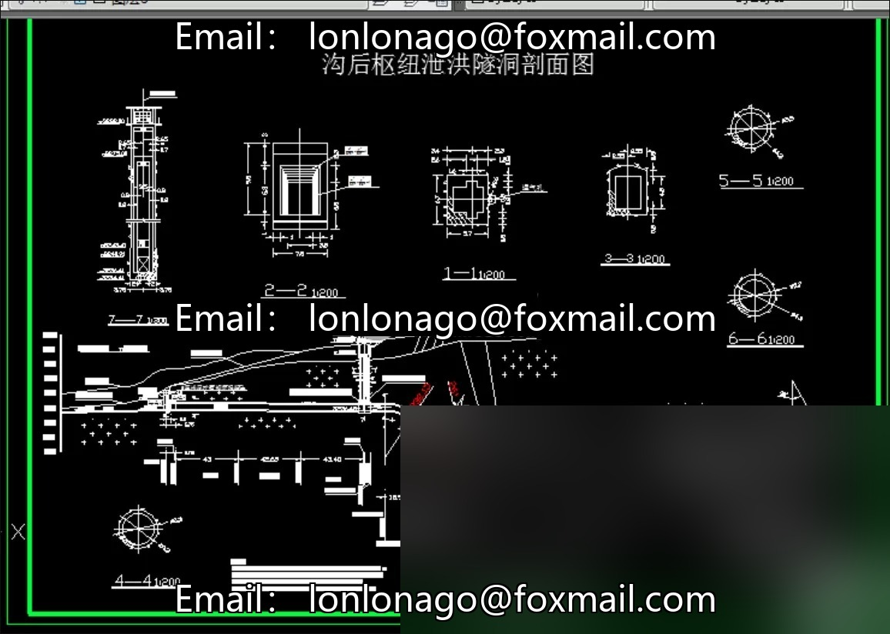
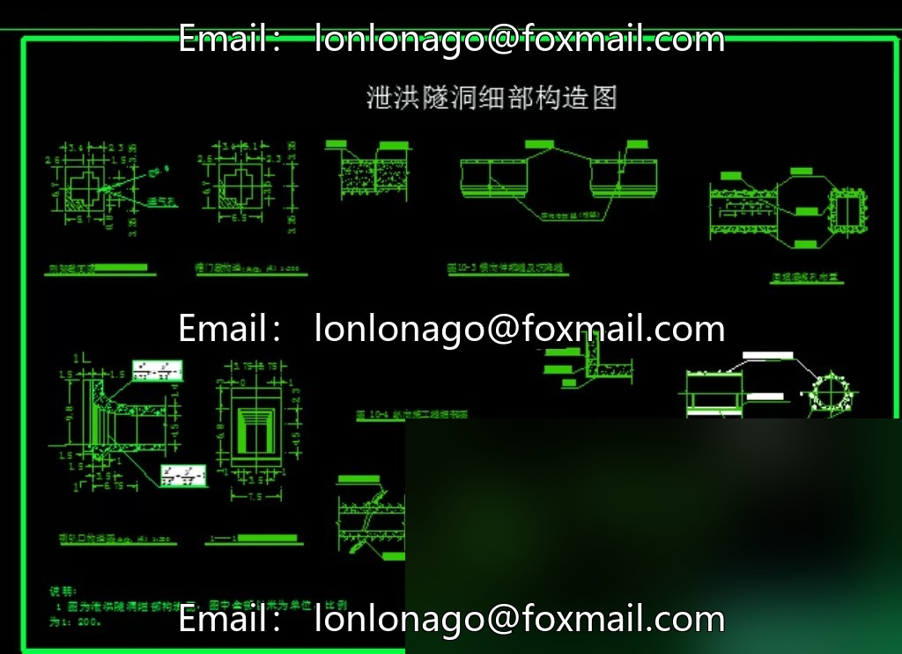

# Soil and rock dam design CAD drawings

## Body

Earth and rock dam design CAD drawings, earth and rock dam design drawings, earth and rock dam design CAD drawings 409

The drawings include body detail drawings, downstream and upstream dry stone slope protection, counter layers, drainage ditches, water diversion slots, body characteristic cross-section drawings, sewage tunnel profiles, and related construction files.

<!-- AI_ENRICHED -->

## Images

## Payment

Here is a pay link on Stripe ( https://buy.stripe.com/3cs8yP7sY87d0vu9AB ). Please contact me lonlonago@foxmail.com after funding $89, and I will send you a complete data files , thank you!

